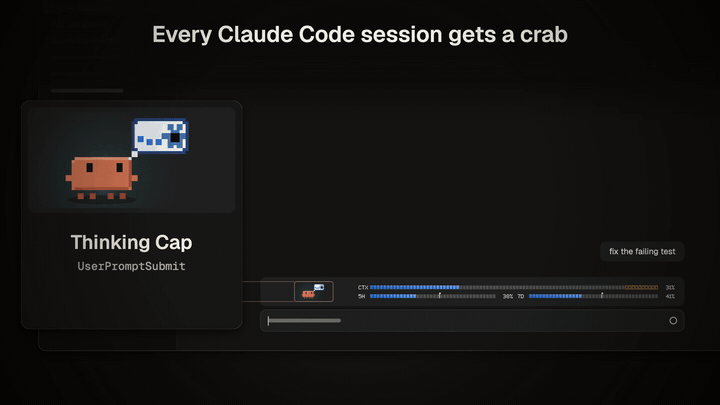

# notch-crab

A small pixel crab that lives above your Claude Code prompt. He acts out what Claude is doing: reading a file, running a test that fails, asking you for permission, finishing the job. Beside him, thin bars show your context window and your 5-hour and weekly usage limits.



More about how it was made: [justinperea.com/lab/notch-crab](https://justinperea.com/lab/notch-crab)

## Install

You need Claude Code 2.1.287 or later in a terminal (`claude --version`). The Code tab in the desktop app runs its own copy of Claude Code, and that copy loads the mod too. Then, in your shell:

```bash
claude plugin marketplace add JustinPerea/notch-crab
claude plugin install notch-crab@notch-crab
```

Inside a Claude Code session you can do both at once with `/plugin install notch-crab --marketplace JustinPerea/notch-crab`. That opens the plugin panel, where you pick a scope.

In the desktop app, add the marketplace from your shell first (the first command above). After that, install it from **+ > Plugins > Add plugin** in the Code tab.

Sessions that are already open pick it up when their plugins reload. In a terminal session, run `/reload-plugins`.

notch-crab is a **mod**, a plugin that runs code inside Claude Code. Current Claude Code has mods on by default, both 2.1.287 in a terminal and the desktop app's own copy. Anthropic can still turn them off on its end. If that happens, the crab won't show.

## What you get

- **The crab.** He reacts to all 33 Claude Code hook events, each with its own little scene: a hard hat and a book for a `Read`, a lock when Claude needs your permission, a cloche when the turn is done. When nothing is happening he wanders and eventually naps.
- **The bars (CTX, 5H, 7D).** CTX is this session's context, measured against the point where auto-compact kicks in, not against the full window. 5H and 7D are your 5-hour and weekly usage limits, each with a flag for how far through its window you are. The bars turn amber, then red, as you get close. The limits only show on a subscription plan. A task-list bar shows up when the session keeps a task list.
- **In the desktop app's Code tab,** the bars take up the room beside the crab and follow the window's width. When the window gets narrow, they move under him.
- **In a terminal,** the crab is pixel art if your terminal can show images (tested in Ghostty). Anywhere else he's drawn in half-block characters.

Every session gets the plain orange crab. Different outfits per session, and the crab in your MacBook's notch, come from the notch-crab desktop app, which isn't released yet.

## Settings

See them with `claude plugin configure notch-crab@notch-crab`, or set them when you install, for example `--config hud=off`. Install says 7 options are not yet set. You can ignore that: each one uses the default below until you change it.

| Option | Values | Default |
|---|---|---|
| `hud` | `on`, `off` (the crab alone, with no usage reads) | `on` |
| `hudContext`, `hudFiveHour`, `hudWeekly`, `hudTasks` | `true`, `false`: one switch per bar. A bar that's off isn't drawn, and nothing is read for it | `true` |
| `show` | `both`, `prompt`, `notch` (`notch` hides the bar above the prompt) | `both` |
| `outfit` | `wardrobe`, `plain` (only matters with the notch app) | `wardrobe` |

## Privacy

- With only the mod installed, nothing leaves your machine.
- On each hook, the mod tries to post a few fields to a local Unix socket, `~/.notch-crab/bridge.sock` (or `$NOTCH_CRAB_SOCKET`), where the notch app would listen. The fields are the event's name, the session id, the tool's name and tool-use id, the subagent id, the notification type and the working directory (the notch app keeps only its last folder name). After a batch of tool calls it also sends a count of how many tools ran. The calls themselves are never sent. Prompts, tool inputs, tool outputs and file contents are never sent. Each post also carries the mod's own `show` setting, and the outfit preset when `outfit` is `plain`. The mod also asks the same socket, by session id, which outfit to wear. When nothing is listening, these fail quietly. The full list of fields is in `mod/hooks/wire.mjs`.
- The bars read the session's usage figures through Claude Code's own API for mods. The task bar counts tasks from the session's transcript and keeps only the counts.

## Uninstall

```bash
claude plugin uninstall notch-crab@notch-crab
claude plugin marketplace remove notch-crab
```

## Development

The mod is in `mod/`. `hooks/register.mjs` is the entry point, and `hooks/engine.mjs` holds the crab, the 33 reactions and the bars, built from the notch-crab engine. To check it, run `claude plugin validate mod` and `claude plugin test mod`. There are 70 tests, which use Claude Code's own test kit.

`hooks/engine.mjs` is generated from the notch-crab engine, which isn't public yet, so please don't edit it by hand. Changes go in `register.mjs`, `hud-state.mjs`, `wire.mjs` and `clawd.mjs`. Some comments mention the notch app's bridge and tests that live in the private repo. Type checking in an editor works once Claude Code has loaded `mod/` from its folder (for example with `claude --plugin-dir mod`), which writes the declarations into `mod/.claude-plugin/types/`.

## Not affiliated with Anthropic

This is an independent fan project. It isn't made, endorsed or supported by Anthropic. Claude, Claude Code and the Clawd character belong to Anthropic. The crab here is a fan redraw of Clawd. The MIT licence covers this project's code, not the character. notch-crab is free and always will be.
